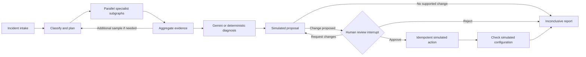

# IncidentPilot

IncidentPilot is a LangGraph proof of concept for investigating operational incidents. It gathers simulated evidence with parallel specialists, synthesizes a diagnosis with Google Gemini or deterministic rules, and pauses for a human decision before applying a simulated configuration change.

The project is designed for an interview demonstration: it makes the graph's state, evidence, tool activity, review decisions, checkpoints, and final report visible in a React dashboard.

> **Simulation boundary:** incident records, logs, metrics, deployments, runbooks, configuration changes, and verification are simulated. In Gemini mode, the incident context, simulated evidence, specialist findings, and relevant saved lessons are sent to Google's API. Do not use confidential incident data without reviewing your provider agreement.

## What it demonstrates

- Typed LangGraph state and reducers that combine parallel specialist findings.
- `Send` fan-out to a specialist subgraph with five typed tools, plus a bounded investigation loop and retry policy.
- A real Gemini structured diagnosis with validated evidence IDs, response metadata, and no silent fallback to demo mode.
- Human review using `interrupt()` and `Command(resume=...)`, including approval, rejection, and change requests.
- SQLite application records and LangGraph checkpoints, so an interrupted local run can resume after a process restart.
- Idempotent simulated actions, configuration-only verification, cross-run lessons, streamed events, checkpoint history, and Markdown report export.



Classification, the extra evidence pass, action templates, and verification are deterministic. Gemini's validated diagnosis and citations are used in the review and final report; it cannot select or execute an action. Citation validation checks that IDs exist, not that every model claim is semantically correct. Model-reported confidence is not calibrated.

## Run locally

Requirements: Python 3.13, Node.js 20.20+ and npm 11. From the repository root in PowerShell:

```powershell
Copy-Item .env.example .env
python -m venv backend/.venv
.\backend\.venv\Scripts\Activate.ps1
python -m pip install -r backend/requirements.txt
npm --prefix frontend ci
```

The default `LLM_PROVIDER=demo` needs no API key. Start the backend in one terminal:

```powershell
.\backend\.venv\Scripts\Activate.ps1
uvicorn app.main:app --app-dir backend --reload
```

Start the frontend in a second terminal:

```powershell
npm --prefix frontend run dev
```

Open [http://localhost:5173](http://localhost:5173). API documentation is at [http://localhost:8000/docs](http://localhost:8000/docs). Both application data and checkpoints are stored in `data/incidentpilot.sqlite3`.

### Use Gemini

In the ignored `.env` file, set `LLM_PROVIDER=gemini` and provide `GEMINI_API_KEY` on the backend. The default model is `gemini-3.5-flash-lite`; set `GEMINI_MODEL` to change it. Restart the API after changing environment variables. Keep keys out of source control and never put them in frontend variables.

The diagnosis panel shows the provider, model, stage, duration, response ID and token counts when Google returns them. The report records those details and the evidence IDs used by the model. Missing credentials, invalid output, rate limits and provider failures produce visible errors; transient failures receive at most one retry.

For a five-minute walkthrough, see [docs/DEMO.md](docs/DEMO.md). The [LangGraph capability matrix](docs/LANGGRAPH_CAPABILITIES.md) maps graph features to the implementation.

## Check the project

With the backend virtual environment active, run:

```powershell
python -m pytest backend/tests -q
python -m ruff check backend/app backend/tests backend/scripts
python backend/scripts/evaluate_demo.py
npm --prefix frontend run build
```

The suite covers provider selection and validation, Gemini response use, invalid citations and provider failures, review branches, action idempotency, and checkpoint resume. The deterministic evaluator runs all three seeded scenarios. A real Gemini 3.5 Flash-Lite call was also exercised locally in October 2026; the response and token usage appeared in the UI and report, and the run resumed after a local API restart. Mock tests and this one live example do not establish general model accuracy.

## Project layout

| Path | Purpose |
| --- | --- |
| `backend/app/graph.py` | LangGraph workflow, tools, review interrupt and simulated actions |
| `backend/app/live_model.py` | Gemini and OpenAI-compatible diagnosis providers |
| `backend/app/database.py` | SQLite records, simulated environment and idempotent writes |
| `backend/app/main.py` | FastAPI, streaming, checkpoints and report export |
| `frontend/src/` | React and TypeScript investigation dashboard |
| `backend/tests/` | Workflow, provider and access-control tests |

This is a single-process local POC. It is not a production incident response system; see [docs/LIMITATIONS.md](docs/LIMITATIONS.md) before adapting it for real services or data.
